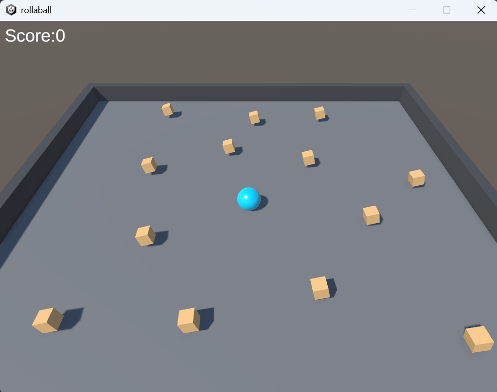

# Roll-a-Ball

一个用 Unity 做的滚球收集小游戏，入门项目。

## 玩法

WASD / 方向键控制小球滚动，吃掉场地上的方块得分。

## 技术点

- Unity 2022.3 LTS + 新版 Input System（Player Input，Send Messages）
- Rigidbody 物理移动，在 FixedUpdate 里 AddForce
- OnTrigger 检测收集物，引入变量Count计分
- TextMeshPro 显示分数

## 怎么运行

1. 安装 Unity 2022.3 LTS
2. 用 Unity Hub 打开这个文件夹
3. 打开 `Assets/Scenes/minigame.unity`
4. 点 Play

## 踩坑记录

- 输入不触发：方法名必须严格匹配（比方说OnMove写成Onmove不生效）
- 方块掉地上：Rigidbody 忘了勾 `Is Kinematic`
- 拖动物体Y轴乱跑：Scene视图坐标是Local，切到Global解决

## 构建

Windows 64位版本，可在Releases下载。

